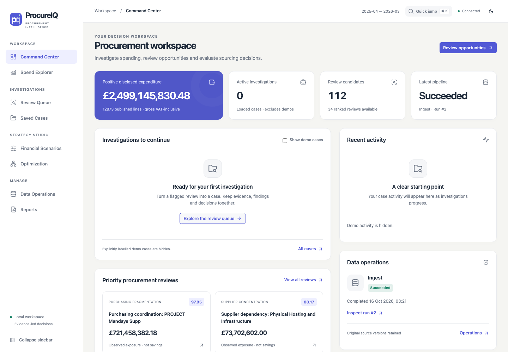
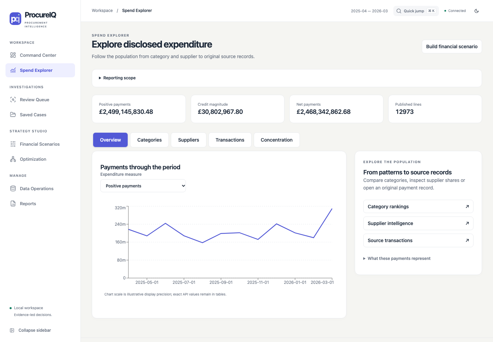
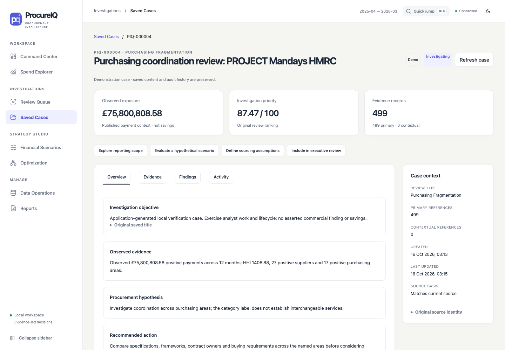
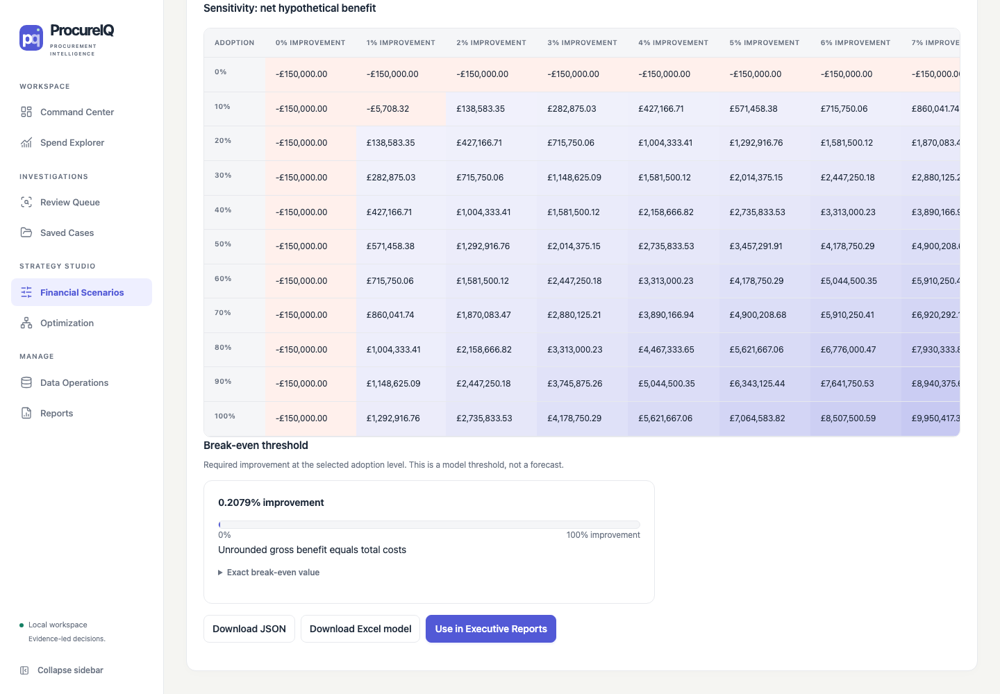
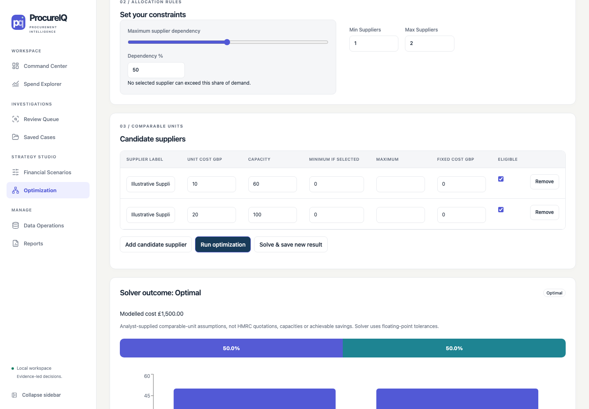
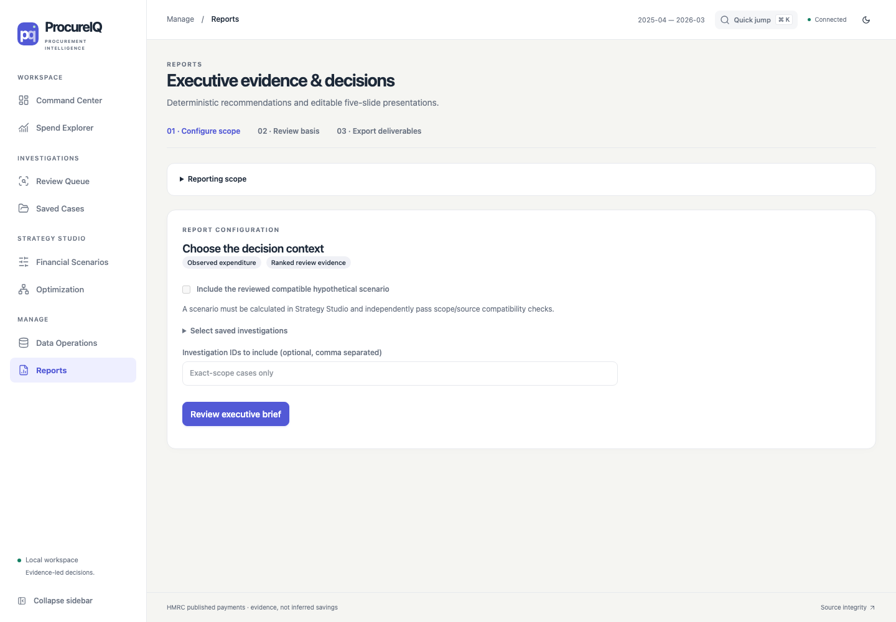
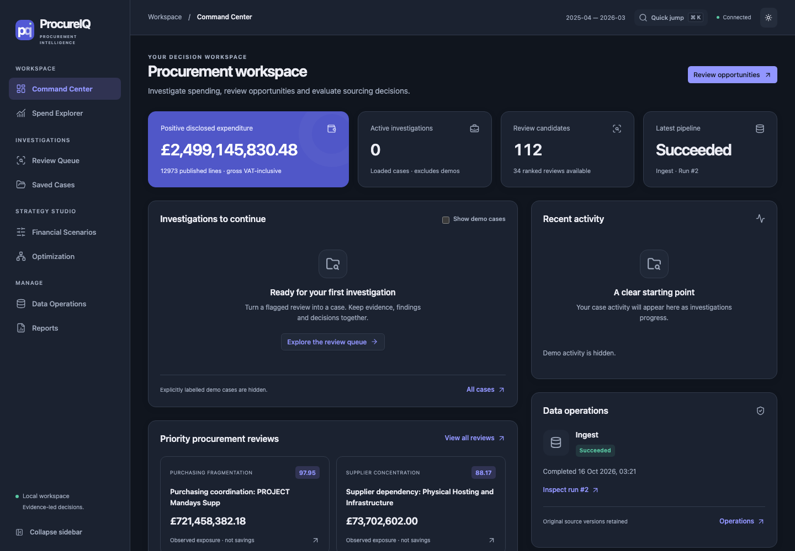

# ProcureIQ

**Procurement spend intelligence built on real public data.** ProcureIQ turns HMRC's published monthly payment disclosures into auditable spend analytics, explainable procurement review candidates, investigation case work and hypothetical cost-optimization scenarios, for procurement and finance analysts who need every number traced back to its source row.



## Highlights

- **Real dataset, fully reconciled:** 12 official HMRC monthly files (April 2025 – March 2026), 12,973 published payment lines, 456 normalized supplier keys and £2,499,145,830.48 in positive disclosed payments, reconciled to the penny with Decimal arithmetic.
- **Explainable opportunity detection:** four deterministic detectors (supplier concentration, purchasing fragmentation, payment patterns and data quality) surface 112 qualified review candidates, each with a score breakdown and links to its original source rows.
- **Investigation workflow:** persistent cases with frozen evidence, bookmarks, notes and findings, revision-checked edits, an append-only activity log and audited status transitions.
- **Financial scenario modelling:** Conservative/Base/Ambitious assumptions, sensitivity grids and break-even analysis, exported to JSON and to Excel workbooks with live formulas.
- **Sourcing optimization:** a mixed-integer linear programming model (SciPy HiGHS) allocates volume across suppliers under analyst-entered costs, capacities and dependency limits.
- **Executive reporting:** generates an editable five-slide PowerPoint with native charts, plus a full evidence JSON that records each recommendation's source lineage.
- **Controlled data operations:** source manifests with hashes, immutable raw records, versioned source activation and a durable, lock-protected pipeline worker with retry.

## Screenshots

| Spend Explorer | Investigation case |
|---|---|
|  |  |
| **Scenario sensitivity** | **Optimization result** |
|  |  |
| **Reports** | **Dark mode** |
|  |  |

Rendered executive slide previews are in [deliverables/screenshots](deliverables/screenshots/slide-1.png).

## Tech stack

| Layer | Technologies |
|---|---|
| Data & analytics | Python 3.11+, Pandas, PostgreSQL 17, SQLAlchemy, psycopg, SQL window functions, Decimal |
| Backend API | FastAPI, Pydantic, Uvicorn |
| Optimization | SciPy (HiGHS MILP) |
| Frontend | React, TypeScript, Vite, Tailwind CSS, Radix UI / shadcn/ui, TanStack Query, React Router, Recharts |
| Reporting | XlsxWriter (formula-driven Excel), python-pptx (PowerPoint) |
| Original dashboard | Streamlit, Plotly |
| Testing | Pytest, Vitest, Testing Library, ESLint, strict TypeScript |
| Infrastructure | Docker Compose (PostgreSQL) |

## Architecture

```
 HMRC CSV files + receipts (manifests/)
              │
              ▼
 Python parser & Pandas profiling ──► quality reports
              │
              ▼
 PostgreSQL: immutable raw rows ─► typed records ─► supplier aliases
              │                     (schema: procureiq)
              ▼
 Parameterized SQL analytics + opportunity engine
              │
      ┌───────┴───────────────────────────────┐
      ▼                                       ▼
 FastAPI /api/v1                         Streamlit app
  ├─ analytics & reviews                  (5-page dashboard)
  ├─ case work ──────► PostgreSQL: procureiq_app
  ├─ Decimal scenario engine ─► JSON / Excel     (cases, events,
  ├─ HiGHS MILP solver                            jobs, saved runs)
  ├─ executive engine ─► PowerPoint
  └─ durable pipeline queue ─► ingestion & reconciliation
      │
      ▼
 React + TypeScript workspace
  Command Center · Spend Explorer · Investigations ·
  Strategy Studio · Optimization · Data Operations · Reports
```

Read-only analytics run in repeatable-read snapshots tied to a source fingerprint, so exports are always checked against the data basis on screen. More detail: [product architecture](docs/product_architecture.md), [technical architecture](docs/technical_architecture.md), [database schema](docs/database_schema.md).

## Results

- **Tests:** 150 Python tests (unit + PostgreSQL integration) and 46 frontend tests passing, as recorded in [workflow verification](docs/product_workflow_verification.md).
- **Analytics:** 112 qualified review candidates on the full dataset. Top-ranked example: purchasing coordination review of a £721,458,382.18 expense category.
- **Scenario example:** illustrative assumptions on that baseline produce £1,292,916.76 Base-case net *hypothetical* benefit ([product verification](docs/product_verification.md)).

All benefits are hypothetical outputs of explicit assumptions, not realized savings. Opportunity scores flag spend worth reviewing; they don't prove inefficiency. See [limitations](#limitations).

## Run locally

Requires Python 3.11+, Node.js, and PostgreSQL 17 (Docker Compose is provided).

```sh
# 1. Python environment
python3 -m venv .venv
source .venv/bin/activate
python -m pip install -r requirements-lock.txt
python -m pip install -e '.[dev]'

# 2. Configuration (edit .env and set a local password)
cp .env.example .env
set -a; source .env; set +a

# 3. Database and data
docker compose up -d --wait db
procureiq download          # fetch the 12 official HMRC files
procureiq investigate       # validate files and profile data quality
procureiq db init
procureiq db load
procureiq db verify
procureiq app-db init       # investigation/application schema

# 4. Frontend dependencies
npm --prefix apps/web ci

# 5. Start the FastAPI (port 8000) and React (port 5173) servers
./scripts/dev.sh
```

Open <http://127.0.0.1:5173> for the app and <http://127.0.0.1:8000/docs> for the API docs. The original Streamlit dashboard is still available:

```sh
streamlit run src/procureiq/ui/app.py --server.port 8501
```

Generate analytical and executive outputs from the CLI:

```sh
procureiq analytics export
procureiq opportunities export
procureiq executive export
```

### Tests

Integration tests need a separate disposable database whose name ends in `_test` (set `TEST_DATABASE_URL`; see `.env.example`):

```sh
docker compose exec db createdb -U "$POSTGRES_USER" procureiq_test
python -m pytest -q
npm --prefix apps/web run lint
npm --prefix apps/web test
npm --prefix apps/web run build
```

## Documentation

- [Product user guide](docs/product_user_guide.md) and [data pipeline](docs/data_pipeline.md)
- [Analytical methodology](docs/analytical_methodology.md), [opportunity methodology](docs/opportunity_methodology.md), [financial scenario methodology](docs/financial_scenario_methodology.md), [optimization methodology](docs/optimization_methodology.md)
- [API reference](docs/product_api.md), [UI design system](docs/ui_design_system.md), [SQL performance](docs/sql_performance.md)
- [Project plan](PROJECT_PLAN.md)

## Data source

[HMRC spending over £25,000](https://www.data.gov.uk/dataset/008d307b-5434-4218-9b62-2eabdef48778/financial-transactions-data-hmrc), published under the [Open Government Licence v3.0](https://www.nationalarchives.gov.uk/doc/open-government-licence/version/3/). Attribution: HM Revenue & Customs. Exact URLs and hashes are recorded in `manifests/`. Raw files are downloaded locally and not committed.

## Limitations

ProcureIQ is a local, single-analyst application, not a deployed procurement system. Payments are gross VAT-inclusive disclosures, not unique invoices or total HMRC procurement spend. Supplier keys are conservative name matches, not verified legal entities. High concentration does not by itself indicate inefficient procurement, and payment variations do not establish fraud or overpayment.

## License

[MIT](LICENSE)

---

Built by Rishith Rai
