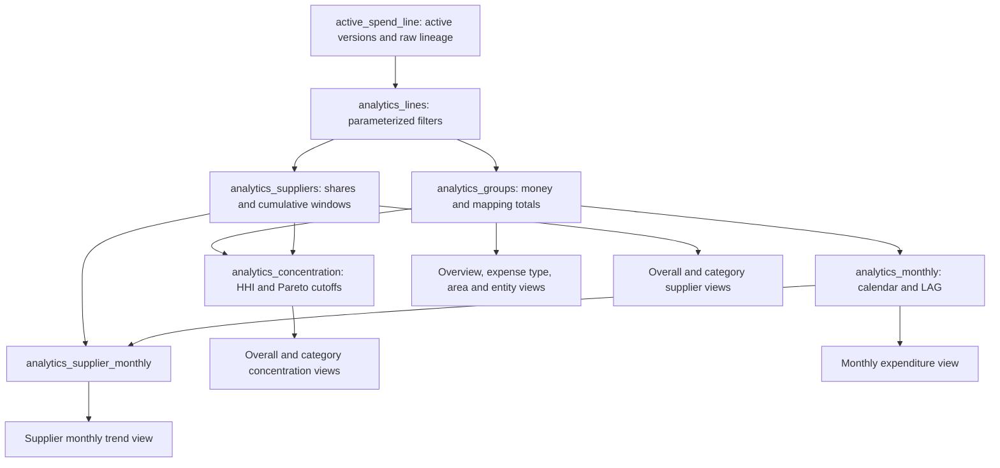

# Analytical methodology — Milestone 3

## Population, dates and money

The analytical population consists of `spend_line` records joined one-to-one to `raw_spend_row` and active, successfully loaded `source_file` versions. No transaction ID or duplicate-row deduplication takes place. Every output uses reporting month, independently of the payment date retained on individual records. Source amounts are gross VAT-inclusive disclosed payments, not total HMRC procurement expenditure or addressable savings.

For each selected population:

- `positive_gbp = SUM(amount_gbp WHERE amount_gbp > 0)`.
- `credit_gbp = -SUM(amount_gbp WHERE amount_gbp < 0)`.
- `net_gbp = SUM(amount_gbp)`; exactly `positive_gbp - credit_gbp`.
- `record_count` includes every selected line, including zero, negative and invalid lines.
- NULL amounts contribute no money and are counted in `unparsed_amounts`. Invalid date or other validation status is counted in `invalid_rows`; an otherwise valid amount remains included by known reporting month.
- All amounts and ratios use PostgreSQL NUMERIC and Python Decimal. Money comparisons are exact, never floating point. NUMERIC division has finite scale; independent checks allow at most `1e-12` absolute discrepancy for nonmonetary ratios only. CSVs retain returned NUMERIC precision; Markdown rounds display values to two decimals.

A missing denominator yields NULL through `NULLIF`, including zero total positive payments. NULL is not zero concentration. Empty filters produce empty grouped/ranking results and zero totals in the verification result, with calendar rows where source coverage is known. A zero-only category is retained with NULL HHI/Pareto ratios.

## Supplier identities and coverage

Supplier identities reuse Milestone 2's casefold-and-whitespace mapping. Original source names remain available through the raw/spend/alias tables. Canonical labels are deterministic lower-case matching keys, not verified legal-entity names. No punctuation, legal suffix, postcode, corporate relationship or fuzzy merge is introduced.

Unresolved supplier rows are included in expenditure totals but excluded from supplier ranking, Pareto and HHI. They are never grouped into a fictitious supplier identity. Overview/category/area/entity outputs expose unresolved positive payments, credits, net amounts and row counts. Concentration outputs expose unresolved positive payments and the resolved denominator.

`mapping_coverage_pct = 100 × resolved_positive_gbp / positive_gbp` measures **positive-payment value coverage**, not row coverage. It is NULL when positive payments are zero. `supplier_count` counts distinct resolved IDs having any selected line; `positive_supplier_count` counts those receiving any selected positive amount. The current full dataset has 456 resolved keys, but 455 with positive payments; the latter is the Pareto count denominator. Counts of categories/areas exclude NULL classifications; monetary groupings retain a NULL classification bucket.

## Rankings, shares and activity

`analytics_suppliers` aggregates each resolved supplier's positive, credit and net amounts after filtering. Rankings use positive GBP descending, normalized key under PostgreSQL `C` collation, then supplier ID. `ROW_NUMBER` gives deterministic positions even for equal amounts. Zero-positive and credit-only suppliers remain in the intelligence output after positive suppliers.

Two share measures are intentionally separate:

- `share_all_positive_pct = 100 × supplier_positive / all_selected_positive`, including unresolved money in the denominator.
- `share_resolved_positive_pct = 100 × supplier_positive / selected_resolved_positive`, the identity-based denominator.

Activity counts measure distinct selected reporting months, expense types and expense areas with any line; they do not imply continuous operational activity. Supplier-level monthly trends use a calendar spine, including zero payments in covered months without matching lines.

## Pareto

Overall and category supplier distributions compute cumulative positive payments using `SUM(...) OVER (... ROWS BETWEEN UNBOUNDED PRECEDING AND CURRENT ROW)` in the deterministic ranking order.

`cumulative_resolved_pct = 100 × cumulative_positive / resolved_positive`.

`suppliers_to_80` is the smallest position whose cumulative positive payments reach or exceed 80% of resolved positive payments, including the supplier crossing the threshold. The SQL compares `cumulative × 5 >= resolved × 4`, avoiding a division-rounded threshold decision. `suppliers_to_80_pct` divides that count by the number of resolved positive-payment suppliers. With no resolved positive denominator, both values are NULL. All unresolved positive amounts remain separately disclosed, so an identity-based Pareto is not falsely described as covering all expenditure when mapping is incomplete.

The cumulative distribution is available through the supplier-ranking views; overall and category Pareto cutoff statistics are in the corresponding concentration views.

## HHI and top-supplier concentration

For resolved supplier positive amounts `p_i` and `P = SUM(p_i)` in the selected category/population:

```
HHI = 10,000 × SUM(p_i²) / P²
Top one % = 100 × MAX(p_i) / P
Top three % = 100 × SUM(the three largest p_i) / P
```

This algebraically equivalent HHI formulation avoids squaring individually rounded shares. One positive supplier yields 10,000; two equal suppliers yield 5,000. Fewer than three positive suppliers naturally yield top-three concentration of 100%. No positive denominator yields NULL, including unknown-only categories. HHI is computed on resolved expenditure only; mapping coverage accompanies it.

The report orders categories by HHI and then positive-payment materiality. It separately reports the count of categories with a single positive supplier. No regulatory threshold, inefficiency label, savings estimate or opportunity score is assigned. This is concentration within a disclosure sample, not an antitrust market definition.

## Fragmentation and materiality

Category outputs report distinct resolved suppliers (all activity and positive activity separately), distinct nonblank/non-NULL expense areas, all positive payments, credits/net, HHI, top-one/top-three shares, and category materiality.

`materiality_pct = 100 × category_positive / positive_payments_across_all_categories_in_the_selected_population`.

The report's fragmentation table orders by positive supplier count then positive payments, without asserting that services are commercially comparable. Many suppliers and low concentration are descriptive characteristics, not proof that aggregation would improve procurement. Combining expense areas may be inappropriate; concentrated expenditure can also reflect legitimate contract scope.

## Dynamic filtering and safety

Python entry point: `procureiq.queries.query(connection, output_name, filters)`.

Supported filter keys are `start_month`, `end_month` (inclusive `YYYY-MM` or first-of-month date), `expense_type`, `expense_area`, `entity`, and `supplier_id` (positive integer). Text filters are exact source-field matches, including case. Supplier selection uses the normalized supplier ID from supplier outputs, so all its raw aliases are included. Omitted filters are unrestricted; each text/ID filter selects a single value. Multi-select filters and an explicit unresolved-only selector are not implemented in this milestone.

All filters apply in `analytics_lines` before aggregation, ranking, cumulative sums, shares or HHI. Concentration is never summed or averaged from precomputed monthly/category HHI. Filtering to one supplier changes the population and generally gives HHI 10,000; that result describes only that selection. Category and overall functions use the same filters and formulas.

User values are SQLAlchemy bind parameters with explicit PostgreSQL casts. Output identifiers and sort clauses come from a fixed code allowlist; user input is never interpolated into SQL identifiers or expressions. The text-filter injection test verifies that SQL-looking text is treated as a literal filter value. Direct SQL functions expect validated first-of-month dates; use the Python access layer for validated input.

CLI commands use a read-only repeatable-read snapshot. Verification, output queries and source/migration metadata within a command see the same state. Analytics performs no database writes. Export CSVs must be imported as data in spreadsheet software; source labels are retained verbatim.

## Calendar trends and missing coverage

Monthly functions use a generated month sequence, bounded by requested start/end months or the earliest/latest active source month. A source-covered month with no matching lines has zero payments. A missing source month has `source_available = false` and NULL amounts. Row counts remain zero because no source rows are available; do not interpret that as confirmed zero HMRC spending.

`mom_positive_pct = 100 × (current_positive - previous_calendar_month_positive) / previous_calendar_month_positive`.

`LAG` runs over the calendar spine, not just months with matching transactions. A missing previous month or zero prior denominator produces NULL. The first month inside the selected window has NULL MoM; no hidden out-of-window baseline is used. The supplier-month function applies the same rule independently per resolved supplier. Source coverage refers to publication files, not proof that every supplier/category is fully disclosed.

## SQL functions and view dependencies

All definitions are in `sql/003_analytical_views.sql`. Original migrations remain unchanged.



| View | Shared SQL function |
|---|---|
| `vw_expenditure_overview` | `analytics_groups('overall')` |
| `vw_expense_type_spend` | `analytics_groups('expense_type')` |
| `vw_expense_area_spend` | `analytics_groups('expense_area')` |
| `vw_entity_spend` | `analytics_groups('entity')` |
| `vw_supplier_ranking` | `analytics_suppliers(FALSE)` |
| `vw_category_supplier_spend` | `analytics_suppliers(TRUE)` |
| `vw_supplier_concentration` | `analytics_concentration(FALSE)` |
| `vw_category_concentration` | `analytics_concentration(TRUE)` |
| `vw_monthly_disclosed_spend` | `analytics_monthly()` |
| `vw_supplier_monthly_trends` | `analytics_supplier_monthly()` |

Views are convenient unfiltered wrappers. The Python layer calls the same SQL functions with bound filters, avoiding duplicate formula implementations. CTEs separate filtering, aggregation and ranking; window SUM supports Pareto, ROW_NUMBER supports deterministic ranking, LAG supports temporal comparison, FILTER separates signed money, and conditional aggregation computes top-three shares. Supplier joins are to unique IDs only. There is no join to `data_quality_issue`, which would multiply transaction amounts.

## Exports and evidence

`procureiq analytics export` writes ten CSVs to `reports/analytics/full/`, alongside `basis.json` and `verification.json`, and regenerates `reports/milestone3_findings.md`. The basis records filters, monetary/date conventions, active filenames/hashes and applied migration hashes. Filtered exports default to separate deterministic `reports/analytics/filtered_<hash>/` directories and do not overwrite the full-period findings. `--output` selects another CSV output directory. CSV NULLs are blank cells; zero is a numeric zero.

`analytics verify` independently computes money and group totals, supplier ranks/shares, Pareto thresholds, HHI/top shares and monthly/supplier-month trends in Python Decimal from selected underlying lines. Money sums across each of expense types, expense areas, entities and months must reconcile. The separate `procureiq db verify` confirms the original frozen source rows, hashes and monthly baseline; use both for full acceptance.

Tests use only the guarded `procureiq_test` database. Synthetic fixtures exercise unequal/equal/single-supplier HHI, unknown mappings, aliases, credit-only and zero groups, NULL classifications, duplicate-looking lines, parameter binding, all filter dimensions, inactive versions, missing months and MoM denominator handling. Actual-data integration checks exercise all 12,973 rows and view/function parity. Full run results are recorded in `docs/milestone3_verification.md`.

This engine supports descriptive supplier intelligence. No Opportunity Radar, Streamlit, scenario model or AI functionality is implemented.
