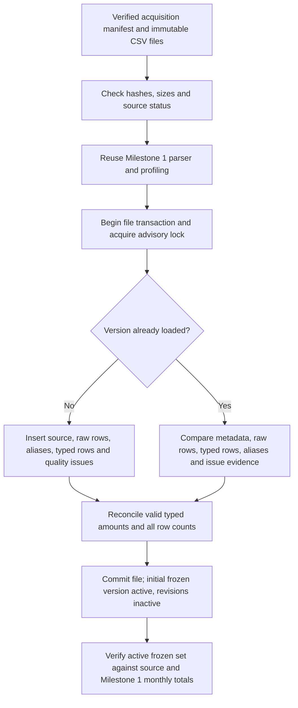

# Data pipeline — Milestone 2

## Setup and configuration

Python dependencies are installed with the README commands. SQLAlchemy uses psycopg 3; `DATABASE_URL` must use `postgresql+psycopg://`. The application reads exported environment variables; it does not implicitly read `.env`. The SQL migration files are repository resources: run from the repository root or pass `--root /path/to/ProcureIQ`.

For a new Docker-based setup:

```sh
cp .env.example .env
# Edit .env: choose a password and use the same value in both URLs.
# URL-encode any reserved characters in URL passwords.
set -a
source .env
set +a
docker compose up -d --wait db
procureiq db init
procureiq db load
procureiq db verify
```

The Compose service runs only PostgreSQL, bound to loopback, with a persistent volume. It does not run the application or add infrastructure. Never use `docker compose down -v` to stop a database whose contents you want to retain; `docker compose stop db` preserves the volume.

For the actual verified setup on this workstation, PostgreSQL **17.11 (Homebrew)** was already installed. A separate cluster is stored in ignored `.local/postgres`, listening on **127.0.0.1:55439**. Its credentials are in ignored, mode-0600 `.env`. Existing services were not altered. Start/stop it from the repository root:

```sh
/opt/homebrew/opt/postgresql@17/bin/pg_ctl -D .local/postgres -l .local/postgres.log -o '-h 127.0.0.1 -p 55439' start
/opt/homebrew/opt/postgresql@17/bin/pg_ctl -D .local/postgres stop
```

Do not start Compose on the same port while this native server is running. Docker setup is supplied for reproduction; the executed verification used native PostgreSQL, not Docker. With an existing PostgreSQL instance, create a dedicated `procureiq` database, set `DATABASE_URL`, then run the same three CLI commands. No administrator password is committed.

## Workflow



`manifests/milestone1_baseline.json` freezes the approved receipts and monthly profile values. The default load requires precisely this set of month/hash pairs. Preflight validates all sources before writes. Each file then loads in a transaction; any failure rolls back all metadata, rows, aliases and issues for that file. Successfully loaded earlier files remain committed, and reruns verify them rather than duplicating them. Identity sequence gaps after rollbacks are harmless.

A rerun checks full raw field contents and deterministic hashes, physical lines and ordinals, every typed field and supplier reference, source metadata, issue evidence, and exact totals. Conflicting values raise an error. Mappings are not silently rewritten. Parsed invalid records still have one typed row with NULL invalid values. Reconciliation for a version sums its successfully validated/storable amounts; exclusions retain issues and source values and are visible in the views. Frozen-baseline acceptance additionally requires all original monthly totals to match.

## Source revisions

Original files are never replaced by ingestion. For a newly published version:

1. Acquire the official bytes under a **new filename** in `data/raw/`; retain the original file and receipt.
2. Create a separate JSON receipt manifest using the existing receipt fields: reporting month, filename, official URL, SHA-256, byte size, actual acquisition timestamp and verified/downloaded status. Only use a verified official download; changing a status string is not a substitute for provenance verification.
3. Register/load with `procureiq db load --manifest manifests/revision_sources.json`. A changed hash registers a separate, **inactive** version. Review its source differences and issues using SQL; the original active version is unchanged.
4. Explicitly select it with `procureiq db activate YYYY-MM FULL_SHA256`. This checks local bytes, row contents, issue evidence and totals, then switches the active version transactionally.

A previously loaded original version can be reactivated using its original month/hash. A normal load never reverses an explicit activation. Default `db verify` is deliberately a **frozen Milestone 1 acceptance gate** and fails while a different version is active. Changing the acceptance baseline requires a separately reviewed update, not automatic replacement. The minimal views always follow the active selection, including for future revisions.

## Supplier identity policy v1

The matching key is `" ".join(original_name.casefold().split())`: trim, collapse all whitespace, casefold. Canonical name equals this key, making selection deterministic regardless of load order. Preserve the original exact string in both raw records and `supplier_alias`; retain the original supplier text in spend lines. Method `case_whitespace_v1` means automated resolution, not human verification. `reviewed_at` stays NULL until a human review mechanism is introduced; `mapped_at` records automation time.

Punctuation, legal suffixes, spelling, company relationships and postcodes are never used to merge suppliers. `reports/supplier_mapping_review.csv` highlights punctuation similarities between **different** matching keys. Each key keeps its own supplier identity pending review. The two groups in this dataset concern Bristol City Council and D.G. Resources; neither is merged automatically.

Placeholder policy (`placeholder_v1`) is explicit in `supplier_identity.py`: exact normalized values such as empty, `n/a`, `unknown`, `not available`, `not disclosed`, `withheld`, `name withheld`, `redacted`, `[redacted]`, `various`, `various suppliers`, `confidential`, `individual` and `private individual`; strings consisting only of whitespace/asterisks/hyphens/x; or a leading `redacted` token (optionally bracketed). Every such alias has a NULL supplier reference and an unresolved issue on each row. Distinct unknown names are not merged into a supplier. Repeated identical placeholder strings can share an alias record but still represent unresolved row identities. Real personal names and company names merely containing a word like “unknown” are not automatically redacted.

These rules found no placeholders among this frozen dataset's names. This is a rule-based finding, not proof that all published names identify independently verified legal entities. Punctuation candidates are review suggestions, not claims of equivalence.

## Integration-test isolation

Tests need an explicitly set `TEST_DATABASE_URL`. For Docker, create the disposable database once:

```sh
set -a
source .env
set +a
docker compose exec db createdb -U "$POSTGRES_USER" procureiq_test
python -m pytest -q
```

For the native setup, the separate `procureiq_test` database is already created. Run the environment export and Pytest commands directly. The test harness rejects a name without `_test`, rejects a database name equal to the main URL's database, verifies `current_database()` before mutation, and resets only the `procureiq` schema inside that test database. Never point the test URL at valuable data. Without a test URL, PostgreSQL tests skip explicitly; that is not evidence that integration passed. The recorded completion run supplied both URLs and executed all tests.
