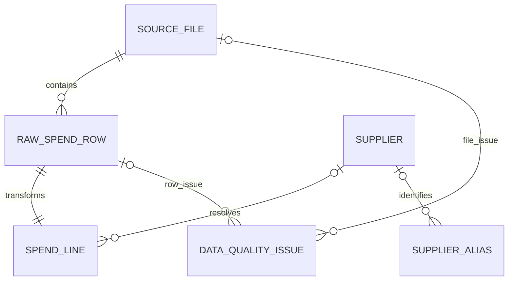

# PostgreSQL schema — Milestone 2

The implementation is in `sql/001_schema.sql` and `sql/002_verification_views.sql`, in the dedicated `procureiq` schema. Migrations run in a transaction, serialized by an advisory lock. `schema_migration` records each filename, SHA-256 and application time; editing an applied migration raises an error. Add new numbered migrations for future changes. No ORM models or external migration framework are needed.

| Table | Design and guarantees |
|---|---|
| `source_file` | BIGINT identity key; month DATE constrained to its first day; URL and filename TEXT; SHA-256 CHAR(64); size BIGINT; original count INTEGER; acquisition/import TIMESTAMPTZ; import status and active flag. Unique `(reporting_month,sha256)` and a partial unique index on active reporting months. Active files must be loaded. |
| `raw_spend_row` | BIGINT identity key and file FK; unique `(file_id,source_record_number)`; physical start/end INTEGER; original decoded JSONB and canonical JSON SHA-256. Update/delete trigger prevents ordinary row mutation. |
| `spend_line` | BIGINT identity key and unique non-null raw-row FK; DATE payment date; TEXT source descriptors/identifier/postcode and optional fields; nullable supplier FK; `NUMERIC(20,2)` GBP; valid/invalid parse status. Valid records require date and amount. |
| `supplier` | BIGINT identity key; unique TEXT normalized key; deterministic canonical name equal to that key (casefolded and collapsed whitespace). This is an operational matching identity, not independent legal-entity verification. |
| `supplier_alias` | Unique exact original TEXT name; normalized key; nullable supplier FK; versioned mapping method; auto-resolved/unresolved status; mapping timestamp and nullable human-review timestamp. Unresolved aliases must have no supplier. |
| `data_quality_issue` | BIGINT identity key; exactly one file or raw-row FK; issue code, severity, field, JSONB details; observation timestamp; nullable resolution timestamp. Row issues reach the file through the raw row, preventing contradictory references. |

The raw-row unique index also supports file lookup. The typed-row unique index supports its FK. Additional indexes cover payment date, supplier FKs and issue lookup. Transaction number is deliberately non-unique. Reporting month is derived from the source file and stays separate from payment date.

The unique typed FK enforces **at most** one typed row. Transactional ingestion plus row-level verification enforce **exactly** one for every raw row, including invalid records. The database cannot require the child row to exist using a simple FK; completeness is an explicitly tested ingestion invariant.

Raw JSONB preserves decoded values, not CSV bytes, delimiters, quoting or header order. The original files and their checksums are authoritative. For ragged rows, `__original_fields` and `__original_headers` preserve positional evidence alongside the analysis mapping. The row hash is SHA-256 of UTF-8 JSON with sorted keys, compact separators and unescaped Unicode. Duplicate rows deliberately share a hash and remain distinct by file/record number.

Blank typed fields can be NULL, while raw values retain blank strings and distinguish absent optional columns. Invalid dates/amounts remain NULL with quality evidence; numeric overflow is detected before PostgreSQL can round/coerce it. Values with more than two decimal places are rejected by the parser. All valid monetary calculations use Decimal and PostgreSQL NUMERIC.

The raw trigger and constraints protect ordinary application operations. A database owner can still change schema or truncate tables; this local development setup is not a production access-control system.

Minimal verification views only:

- `active_spend_line`: loaded active versions, with file/record/month lineage.
- `monthly_reconciliation`: row counts, positive payments, credit magnitudes, net, parsing counts and retained sign/threshold counts.
- `supplier_mapping_coverage`: active row and original-name/normalized-key coverage.
- `unresolved_quality_issues`: active-file issues with no resolution timestamp.

A partial unique index enforces the active-version constraint ([PostgreSQL documentation](https://www.postgresql.org/docs/17/indexes-partial.html)). Transaction-scoped advisory locking serializes this application's migrations, imports and activation changes ([locking documentation](https://www.postgresql.org/docs/17/explicit-locking.html#ADVISORY-LOCKS)). Broader analytical views are reserved for Milestone 3.
