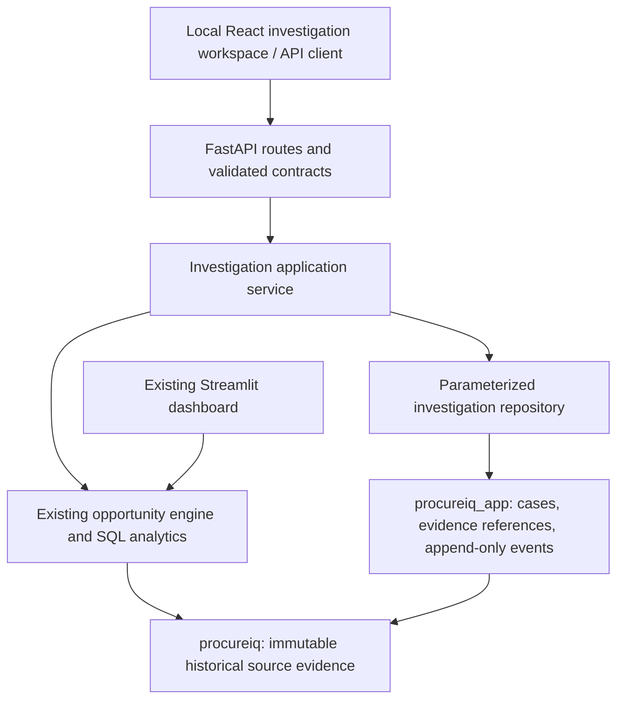

# Investigation application architecture

This is a local, single-analyst backend alongside the existing Streamlit application. FastAPI serves investigation workflows; the existing PostgreSQL functions and Python detectors remain the only procurement calculation implementation. Stage 2 adds a separate React investigation workspace. Authentication, notes editing, bookmarks and optimization remain outside this implementation.

## Reused interfaces

`opportunity_data.retrieve` reads the exact filtered lines, analytical category metrics, calendar coverage and source-reference structures. `opportunities.detect` supplies the existing exported list, scores, configuration and cap exclusions. There is no second detector or financial engine. Filters pass through `queries.validate_filters`.

The source fingerprint implementation moved unchanged to `source_basis.py`. `ui.service` re-exports `fingerprint` and `SourceChanged`, preserving existing imports/public behavior. The API does not import Streamlit or use session state. The original dashboard caches and interfaces remain intact. The investigation adapter recalculates reviews in a consistent database snapshot; it does not introduce an unbounded cache or persist current Radar results as historical cases automatically.

## Modules

| Module | Responsibility |
|---|---|
| `api/app.py` | Local FastAPI factory, thin routes, narrow CORS, body limits and sanitized errors |
| `api/models.py` | Request fields and response contracts; Decimal serialization |
| `investigations/domain.py` | Workflow, disposition vocabulary and typed application failures |
| `investigations/reviews.py` | Existing-engine adapter, canonical review context and summary projection |
| `investigations/service.py` | Transactions, deduplication, source consistency and use cases |
| `investigations/repository.py` | Parameterized persistence and historical evidence pagination |
| `investigations/migrations.py` | Separate checksum-aware application migration runner |
| `source_basis.py` | Framework-independent unchanged analytical fingerprint |
| `sql/app/001_investigations.sql` | Application schema tables, constraints, indexes and protections |

## Application schema

`procureiq_app.schema_migration` is independent of `procureiq.schema_migration`. `procureiq app-db init` reads only `sql/app/`; ordinary `procureiq db init` continues reading the existing top-level SQL migrations. Application initialization is transactional, serialized by its own advisory lock, verifies applied checksums and safely reruns. No application migration appears in the analytical fingerprint.

`investigation_case` stores an identity ID, generated `PIQ-000001` style reference, title/objective, original opportunity identity/type/score, frozen review explanation/metrics, rule and configuration identities, exact filters, source fingerprint and unique review-basis key. JSONB retains original metadata, not thousands of copied transaction payloads. Evidence counts support efficient integrity checks. Status, row version and lifecycle timestamps describe the workflow. Score uses unconstrained PostgreSQL NUMERIC so the original unrounded priority is preserved. Identity sequence gaps after conflicts/rollbacks are normal; references never truncate IDs above six digits.

`case_evidence` stores classification, ordinal, immutable raw-row/file IDs, file SHA-256, source-record number and raw-field hash. Its primary key supports `(case, classification, ordinal)` pagination. Additional uniqueness prevents duplicate source positions within one classification. Foreign keys restrict deleting referenced source files/raw rows. Transaction references are not keys. Inserts use batches of at most 500 rows, supporting the 6,497-reference leading review.

`case_event` stores an immutable event ID, case ID, timestamp, old/new status, reason, change details and the literal actor `local_application`. No employee or organizational account is fabricated. Database triggers reject event/evidence updates and deletes and changes to original case snapshot fields. Cases cannot be deleted through ordinary operations. These protections are not tamper-proof against a database owner who deliberately disables triggers or alters the schema.

Future notes, bookmarks, findings and scenarios can reference `case_id`; a finding/bookmark can cite the evidence composite key. No speculative tables were added.

## Exact review identity and deduplication

The context token hashes canonical JSON containing the validated reporting filters, current analytical source fingerprint, detection-rule version and SHA-256 of the complete server-side opportunity configuration. The case review-basis key hashes that same context plus the server-resolved exported opportunity ID. Configuration is selected by the server, including an optional `PROCUREIQ_OPPORTUNITY_CONFIG` file, never by client-supplied scores/evidence.

Canonical serialization sorts keys and uses the existing opportunity engine's Decimal/date conventions. Omitted fields and explicit null filters normalize identically; valid month strings normalize to first-of-month dates. HTTP clients may echo canonical `YYYY-MM-01` dates directly; request validation normalizes them to the same engine context. The original engine distinguishes unbounded versus explicitly bounded filter contexts in opportunity IDs, even if they happen to select the same current rows. This stage preserves that identity contract; it does not reinterpret or merge those review bases. Display-only detector/minimum-priority filters do not change the underlying review population or case basis.

A client must supply the basis token it observed. The backend resolves that context again, rejects stale/forged tokens, looks up only current exported reviews and computes the key itself. Deferred review IDs receive `review_not_eligible`; unknown or out-of-population IDs receive `review_not_found`. A token is a consistency token, not an authentication secret.

PostgreSQL enforces `UNIQUE(review_basis_key)`. Creation uses `INSERT ... ON CONFLICT DO NOTHING`, never a fragile pre-check. An existing case is returned unchanged, including when CLOSED. Two simultaneous identical requests produce one case. Repeatable-read serialization conflicts retry the complete transaction at most three times, including fresh context validation. A request cannot partially commit a case, evidence or initial event.

## Snapshot and source consistency

Reads use read-only repeatable-read transactions. Creation uses a writable repeatable-read transaction and acquires SHARE locks on source-file and analytical-migration tables **before its first snapshot read**. Activation, ingestion and migration writes to those tables wait until creation commits. If they complete first, the subsequently resolved token differs and the request fails stale. This prevents a source switch from interleaving with review resolution and evidence insertion; it does not modify analytical records. Lock/statement timeouts bound waiting.

Creation validates every server-resolved evidence reference against file ID, SHA-256, record number, physical lines and reporting month, then records the raw-row hash. The case, evidence references and CASE_CREATED event commit atomically. Future unsupported manual edits to analytical typed rows or supplier mappings would require the same immutable-data discipline and additional revision tracking already documented for the dashboard.

## Historical evidence and retention

Saved cases never rerun the detector to replace their score, metrics or references. Their detail indicates `basis_matches_current_source`, comparing the frozen fingerprint with today's active fingerprint. The original rule/configuration remain visible even if current server policy differs.

Evidence queries use stored raw-row/file identities directly, never active views or transaction-number matching. The query selects only the requested reference page before joining immutable source rows. It checks total reference count against the frozen classification count, validates lineage and hashes, and recomputes each returned raw-field hash. Missing/mismatched historical evidence raises `evidence_integrity`; no current row is substituted. Integrity checks are page-scoped, not a claim of rescanning all historical bytes for every case detail request.

Original source versions and raw rows must be retained. Foreign keys protect ordinary deletion, and frozen references remain readable when versions become inactive. External destructive administration can still break retention; the API reports the affected evidence rather than repairing it silently. CSV byte-to-database verification remains the existing `db verify` responsibility.

## Lifecycle and concurrency

Allowed transitions are OPEN → INVESTIGATING → REVIEWED → CLOSED. CLOSED may explicitly reopen to INVESTIGATING. Other transitions and same-status updates fail. Closing requires a documented disposition and meaningful 10–4000 character explanation; reopening requires a meaningful reason. Supported dispositions are `FURTHER_ACTION_RECOMMENDED`, `NO_ACTIONABLE_FINDING`, `INSUFFICIENT_EVIDENCE`. None claims savings or wrongdoing.

Every status request includes `expected_version`. A row lock serializes competing updates; a stale row version receives `case_version_conflict`. Status, incremented version, timestamps/disposition and event commit together. Reopening clears current closure/review fields; previous reasons/dispositions remain in immutable history. Retrieval never changes status.

## Limits

This API has no authentication and must remain bound to loopback. CORS allows only the two documented local React development origins. Application schema separation is a data-model boundary, not a separate database security principal. Current local credentials own both schemas; least-privilege production roles, authentication, deployment and multi-user auditing are outside Stage 1.

Case/activity lists use ascending immutable IDs and bounded offset pagination; concurrent insertions append at the end. Status-filtered lists may change between requests as cases transition; they are not a frozen multi-request browsing snapshot. A case's evidence is immutable, so its ordinal pagination is stable. API review computation is synchronous and has not been load tested. Activity has no retention deletion endpoint. Stage 2 adds only the investigation frontend described below; Stage 3 workflows remain unimplemented.

## Stage 2 React boundary

`apps/web` is an independent Vite/React/strict-TypeScript application. React Router owns Review Queue, Saved Cases and direct case routes. TanStack Query owns abortable reads and parameter-specific ephemeral caches. Plain CSS supplies the responsive shell, list/detail layout, bounded evidence table and native modal dialogs. The typed API client was implemented after inspecting the running OpenAPI schema and actual response bodies.

No backend route, migration, detector, mapping or financial-model change was necessary. The frontend never recalculates procurement measurements. Exact monetary strings pass unchanged through the client; formatting is presentation only. Case creation submits the current server token and canonical reporting filters. Display-only filtering never changes eligibility. Existing cases are opened read-only, including CLOSED cases; a concurrent duplicate response is reported truthfully. Stale creation requires explicit review of refreshed information.

Evidence is requested in 50-row pages and retains both source fields and immutable lineage. Activity is the real append-only event history. Source mismatch and integrity errors remain explicit. The only browser session-storage entry is the last queue URL; no evidence or basis token is persisted there. Query cancellation and unique keys isolate overlapping requests. Inactive cache entries expire after 60 seconds. See the [frontend development guide](investigation_frontend.md) for exact configuration, routes and state conventions and [Stage 2 verification](investigation_stage2_verification.md) for executed acceptance.

## Namespace and historical exploration refinement

Application migrations 004/005 add immutable NORMAL/DEMO namespaces and optional finding sections. Uniqueness is now `(review_basis_key, namespace)`. Request-local namespace checks apply to repository case reads, work mutations, review indicators, counts and reports. Frozen evidence filtering joins saved references to original raw rows/source files and original-version typed amounts, never active views. See [current architecture and workflow](product_workflow_refinement.md).
