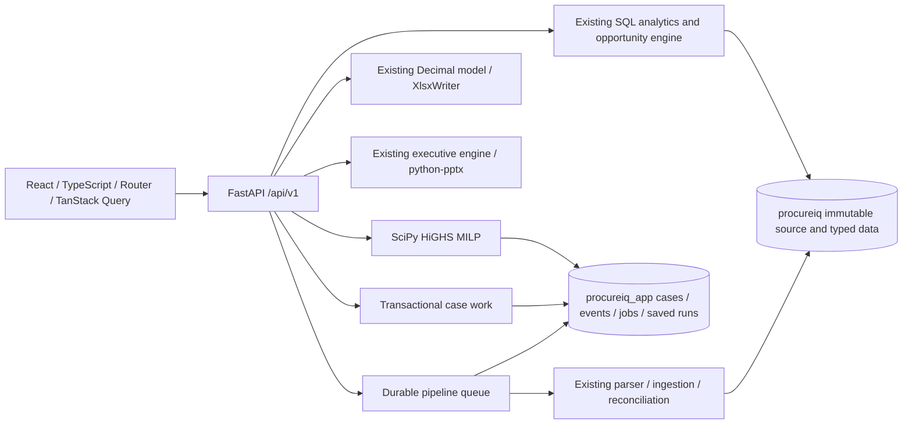

# Complete local application architecture

ProcureIQ has six connected React workspaces alongside the preserved Streamlit application. It is an unauthenticated, single-analyst local application; both servers bind to loopback. CORS admits only the configured local development origins.

`apps/web/src/product` implements Command Center, Spend Explorer, Strategy Studio, Data Operations and Reports. Existing investigation components implement the queue, saved cases and immutable evidence, extended by `CaseWork`. Tailwind provides utilities alongside the established responsive CSS; Recharts is loaded in a separate chunk. Exact financial strings stay strings; chart conversions are display-only.

`src/procureiq/product/analytics.py` adapts existing DashboardService/SQL queries. `optimization.py` owns the new sourcing model. `pipeline.py` owns the controlled durable worker. `investigations/work.py` owns notes, findings and bookmarks. FastAPI routes validate inputs and serialize exact Decimal values. No API import requires Streamlit.

Application migrations 002/003 add analyst work and operation records. Existing analytical migrations remain unchanged. Case work takes a case lock; entry edits require the expected entry revision; mutations and append-only events commit together. Evidence bookmarks reference the existing frozen case/classification/ordinal key. Saved optimization rows and receipt registrations are immutable. Pipeline transitions/stages are durable operational records.

Read-only analytics use repeatable-read snapshots and a source fingerprint. Dependent transaction/group requests submit the displayed basis. Reports recompute and check one basis before exporting. Scenario imports are independently recomputed and validated; stale database baselines require explicit refresh. Historical case evidence continues to resolve original source IDs, independent of active selection. Future unsupported manual supplier/typed-data edits still need their own revision discipline.

The local worker holds a PostgreSQL advisory lock and executes one queued operation at a time. At most eight pending/running jobs are admitted. An orphaned running operation becomes interrupted when a replacement worker obtains the exclusive lock. Retry creates another run and revalidates previously committed files. This is a local bounded worker, not a distributed workflow service or production deployment.
