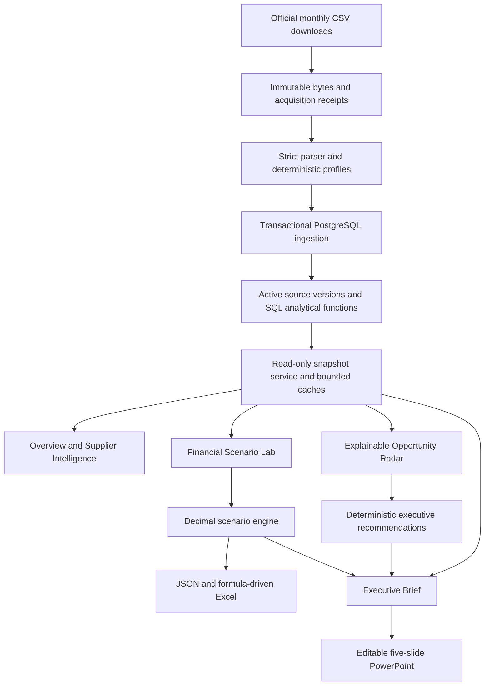

> The complete React product extends this historical documentation. See [product architecture](product_architecture.md), [user/development guide](product_user_guide.md), [API extensions](product_api.md) and [verification](product_verification.md). Existing calculations and source policies remain authoritative.

# ProcureIQ technical architecture

ProcureIQ is a local Python/PostgreSQL analytical application for investigating HMRC payment disclosures. It separates immutable evidence, typed data, analytical observations, review hypotheses and hypothetical benefits.

## Data engineering and PostgreSQL

The acquisition manifest records official URL, reporting month, filename, bytes, SHA-256 and acquisition timestamp. `milestone1_baseline.json` freezes the accepted receipts and monthly totals. Original CSV bytes stay immutable in ignored `data/raw/`. The parser preserves source strings, strict decoding evidence and physical-line/record references; Decimal validates monetary precision. Pandas supports profiling, not an alternative money calculation layer.

The `procureiq` schema stores source versions, lossless decoded raw values, typed spend lines, supplier identities/aliases and quality issues. File-level transactions, advisory locking and rerun comparisons ensure idempotent ingestion. New publisher hashes create inactive versions; explicit activation changes the selected version. Transactions are not unique invoices and transaction identifiers have no uniqueness constraint. Migrations are checksum-verified.

Supplier keys casefold and collapse whitespace only. Punctuation matches remain review suggestions; placeholders retain unresolved identities. Original names remain available. See [schema](database_schema.md), [pipeline](data_pipeline.md) and [reconciliation](data_reconciliation.md).

## Analytical and review layers

Parameterized PostgreSQL functions apply all filters before aggregation. SQL NUMERIC handles money; window functions support deterministic ranks, cumulative shares and Pareto thresholds. HHI uses resolved positive-payment shares. Calendar completion distinguishes missing source coverage from covered zero activity. Independent Python Decimal checks reconcile grouped outputs to selected source lines.

Four deterministic opportunity detectors apply documented materiality, recurrence, coverage and history gates. Their existing priority combines materiality, signal and evidence under versioned configuration. Full primary/context references and exclusion/cap audits remain available. Executive recommendations shortlist the exported population by theme, original priority/materiality and explicit overlap policy; they do not infer financial savings.

## UI and state

Streamlit provides five pages; Plotly draws charts. `DashboardService` owns read-only repeatable-read snapshots, a 12-entry aggregate LRU and three-entry complete-opportunity LRU. A service lock serializes detector cache construction. Source fingerprints cover active source/migration metadata and are checked even on cache hits. Future manual supplier mapping edits need a mapping revision key.

Only requested evidence pages reach widgets. Complete evidence exports are on demand. Sidebar filters are shared; source changes reset filters and detail state. Scenario assumptions live independently of widget state so page navigation preserves them. Binding a scenario pool is explicit; changing filters does not overwrite it. Stale pools block results until reviewed. JSON provides persistence beyond a session. No scenario database table is needed.

The Executive Brief reads all analytical/review inputs in one snapshot. Financial illustration inclusion is explicit and scoped. Its recommendation-to-Radar callback preserves the selected population and opens the corresponding evidence workspace.

## Financial and artifact layers

`financial_model.py` is UI-independent Decimal arithmetic with precision 50 and HALF_UP penny outputs. It preserves unrounded intermediate products and unavailable zero-cost ROI. Sensitivity reuses the same calculation. No annualization or probability model is introduced.

`scenario_io.py` validates JSON structure, numeric inputs, recalculated results and claimed database evidence. `scenario_excel.py` creates four formula-linked sheets using XlsxWriter. `executive_presentation.py` creates five editable slides using python-pptx; `executive export` supplies the source-backed evidence JSON. Browser exports use the same modules as CLI/test generation.

Runtime additions for artifacts are XlsxWriter and python-pptx. openpyxl is a development inspection dependency. Temporary Playwright and presentation render tooling are not application dependencies. See the [financial](financial_scenario_methodology.md) and [executive](executive_methodology.md) methods.

## Verification and local operation

Unit fixtures use independent numerical expectations. Integration tests require a separate database whose name ends `_test`, reject the main database name, check `current_database()` before mutations and reset only that test schema. Main-data gates verify frozen CSV bytes, every loaded record and exact monthly totals. UI tests combine AppTest and actual browser interactions. Artifact acceptance distinguishes cached Excel results from independent formula evaluation, and PPTX package assertions from rendered visual inspection.

The local application binds to loopback. Credentials live in ignored `.env`, never in source. The app reads exported environment variables and does not implicitly load `.env`. No authentication, multi-user persistence, high-concurrency guarantee or production deployment is claimed. Native PostgreSQL setup and Docker reproduction are documented separately. No Git history or remote operations are part of application execution.

## Investigation Backend Foundation — Stage 1

A separate local FastAPI backend now supports persistent investigation cases, frozen historical evidence and audited status transitions in `procureiq_app`. The existing Streamlit dashboard remains unchanged. See [investigation architecture](investigation_architecture.md), [API launch and contract](investigation_api.md) and [executed verification](investigation_stage1_verification.md). No React frontend or Stage 2 work is included.
